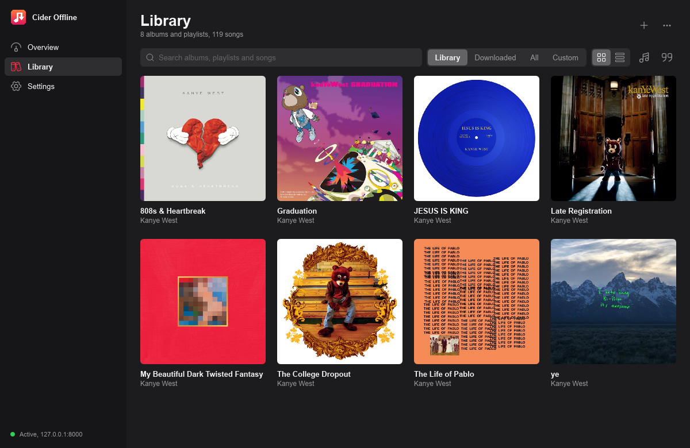

# Cider Offline

Use Cider (Apple Music client) offline: a local proxy that caches your library, downloads songs and lyrics, and serves them when you're offline.



## Features

- Offline mode: Cider keeps working from the local copy when Apple Music is unreachable
- Library sync of your playlists, albums and songs
- Song and music video audio downloads, decrypted locally
- Automatic download of songs as you play them
- Lyrics from Apple Music, Cider Community, AMLL TTML DB, Musixmatch, NetEase Cloud Music, Kugou and LRCLIB
- Custom audio and lyrics (TTML or LRC) per song
- One-click setup of Cider's proxy on Windows
- Start at login, start minimized
- System tray icon
- Portable mode
- Windows (x64, x86, ARM64), macOS (universal, Intel and Apple silicon) and Linux (x86_64, ARM64)

## Requirements

- [Cider](https://cider.sh) 4, the current release from the Cider Collective.
- An Apple Music subscription, signed in to Cider.
- Windows 10 or 11, macOS 11 or newer, or a Linux desktop with X11 or Wayland. On Linux the app needs `certutil` from the NSS tools (`libnss3-tools` on Debian and Ubuntu, `nss-tools` on Fedora, `nss` on Arch). The packages pull it in; for the AppImage install it yourself.

## Getting started

1. Download the installer or the portable archive for your system from [Releases](https://github.com/semicolonmystery/cider-offline/releases). Windows has a setup `.exe`, macOS a `.dmg`, Linux an AppImage, `.deb`, `.rpm` and an Arch package. The portable archives run from wherever you unpack them. The builds are not signed, so your system warns you the first time; [Installation](https://cider-offline.podik.cz/docs/installation.html) explains how to get past that on each OS.
2. Start Cider Offline and click **Install** on the **Certificate** row of the Overview page (it says **Fix** when the app couldn't read the trust store). The app creates its own certificate authority on your computer so it can read Apple Music traffic, and your system asks you to confirm.
3. Connect Cider. On Windows, turn on **Route Cider through this proxy** on the Overview page. On macOS and Linux, start Cider with `--proxy-server=127.0.0.1:8000`; the Overview page shows the exact command. See [Connecting Cider](https://cider-offline.podik.cz/docs/connecting-cider.html).
4. Use Cider online once so the app can sync your library and pick up your Apple Music session. After that, download what you want to have offline.

[Using the app](https://cider-offline.podik.cz/docs/using.html) covers the library, downloads and lyrics. If something goes wrong, start with [Troubleshooting](https://cider-offline.podik.cz/docs/troubleshooting.html). To remove the app and everything it created, see [Uninstalling](https://cider-offline.podik.cz/docs/uninstalling.html).

## Configuration

Settings live in `config.toml`:

- Windows: `%APPDATA%\cider-offline\CiderOffline\config\config.toml`
- macOS: `~/Library/Application Support/sh.cider-offline.CiderOffline/config.toml`
- Linux: `~/.config/cideroffline/config.toml`
- Portable: `data/config/config.toml` next to the program

Most options are also on the Settings page. The app rewrites the file when you change a setting there, so close it before editing the file by hand. The ones you are most likely to want:

- `proxy.port` (default `8000`): the port Cider connects to.
- `auto_cache`: `off`, `instant` (download a song as soon as it plays) or `deferred` (wait until you stop playing for a while).
- `download_concurrency`: how many downloads run at once, 1 to 6 (default 2).
- `lyrics.providers`: which lyrics providers are asked, and in what order.
- `connectivity.force_offline`: behave as if Apple Music were unreachable, to check what works offline.

Every option is listed in [Configuration](https://cider-offline.podik.cz/docs/configuration.html), and [Files](https://cider-offline.podik.cz/docs/files.html) lists where the rest of the data goes.

## Development

You need a stable Rust toolchain no older than the `rust-version` in `Cargo.toml` (currently 1.95), plus:

- Windows: the MSVC toolchain (Visual Studio Build Tools with "Desktop development with C++"). The GNU toolchain is not supported.
- macOS: the Xcode command-line tools (`xcode-select --install`).
- Linux: pkg-config and the xcb, xkbcommon and fontconfig development packages, plus `libnss3-tools`. `packaging/ci/install-linux-deps.sh` installs the exact list on Debian and Ubuntu.

Run the app:

```sh
cargo run -p cider-offline
```

Before you call a change done, all three of these must pass:

```sh
cargo fmt --all --check
cargo clippy --workspace --all-targets -- -D warnings
cargo test --workspace
```

How the workspace is laid out, how the proxy works and how releases are built is in [Development](https://cider-offline.podik.cz/docs/development.html) and [How it works](https://cider-offline.podik.cz/docs/how-it-works.html).

## Contributing

Issues and pull requests are welcome; read [CONTRIBUTING.md](CONTRIBUTING.md) first.

## Disclaimer

Cider Offline is for personal use with your own Apple Music subscription. It is not affiliated with or endorsed by Apple or the Cider Collective. It decrypts content you are already licensed to stream so you can play it offline on your own machine. Use it at your own risk.

## License

MIT, see [LICENSE](LICENSE). Use it, change it, share it; just keep the copyright notice.
