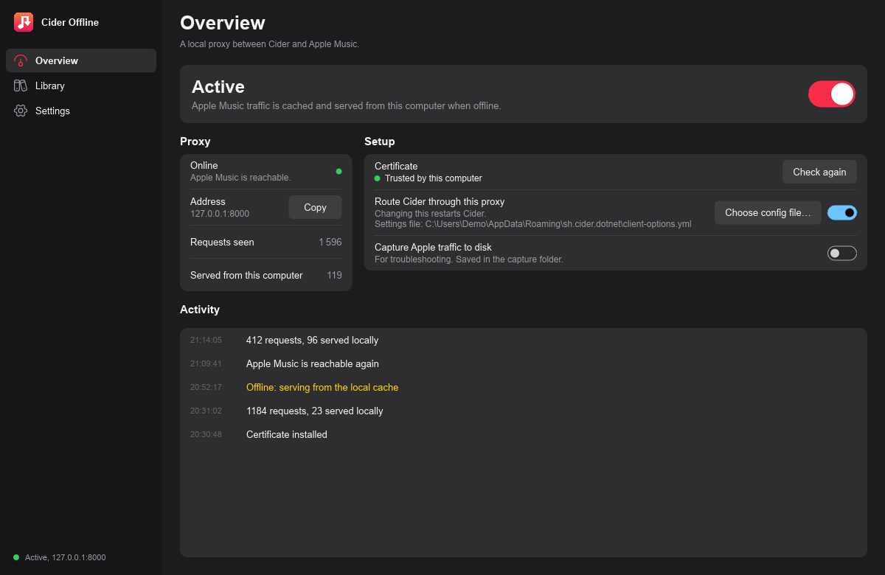

# Connecting Cider

Cider has to send its traffic through the proxy, and it has to trust the proxy's certificate. The certificate is covered in [Installation](installation.md#first-run-and-the-local-certificate). This page covers the proxy setting.



The examples use the default address, `127.0.0.1:8000`. If you changed the port, the Overview page shows your address, and the commands it shows already include it.

## Windows

The Windows build of Cider has its own proxy setting, and the app can turn it on for you. On the Overview page, turn on **Route Cider through this proxy**.

Behind the switch, the app edits Cider's settings file, `%APPDATA%\sh.cider.dotnet\client-options.yml`:

```yaml
UseProxy: true
ProxyServer: 127.0.0.1:8000
```

Cider reads this file only when it starts and rewrites it when it exits, so the app makes the change while Cider is closed:

- If Cider is running, the app asks it to close, writes the file and starts Cider again. If Cider hasn't closed after 10 seconds, the app ends it.
- If Cider isn't running, the app writes the file and leaves Cider closed. The change applies the next time you start it.

Turning the switch off sets `UseProxy: false` and leaves `ProxyServer` as it is. The app changes only those two lines and leaves the rest of the file exactly as Cider wrote it.

If Cider keeps its settings somewhere else, the row says the file was not found. Click **Choose config file…** and pick Cider's `client-options.yml`. The app remembers the choice (`cider_config_path` in [the config](configuration.md)), and the row shows which file it uses.

You can also make the change by hand: close Cider, set `UseProxy: true` and `ProxyServer: 127.0.0.1:8000` in `client-options.yml`, and start Cider again.

## macOS and Linux

Cider on macOS and Linux is a different build, and it has no proxy setting the app could change. Instead you start Cider with Chromium's `--proxy-server` option, and the app never touches Cider's files there. The Overview page shows the exact command under **Use Cider with this proxy**.

On macOS, quit Cider and start it from Terminal:

```sh
open -a Cider --args --proxy-server=127.0.0.1:8000
```

On Linux, quit Cider and start it with:

```sh
cider --proxy-server=127.0.0.1:8000
```

or, for the Flatpak:

```sh
flatpak run sh.cider.Cider --proxy-server=127.0.0.1:8000
```

The option applies only to the Cider you start this way. If you start Cider from the Dock, the app menu or a launcher, it runs without the proxy. To make it permanent, change your launcher or desktop entry to pass the option.

Instead of the option you can set a proxy for the whole system: on macOS in **System Settings > Network > (your network) > Details > Proxies**, on Linux in your desktop's network settings. Set both the HTTP and the HTTPS proxy to `127.0.0.1` port `8000`. This sends every app that follows the system proxy through Cider Offline. Apart from Apple Music hosts, the traffic passes through untouched, but it all stops working while the app isn't running.

## Checking that it works

With Cider running, the **Requests seen** counter on the Overview page goes up as you use Cider. If it stays at 0, Cider isn't using the proxy. If Cider shows network errors as soon as it goes through the proxy, the certificate isn't trusted yet. [Troubleshooting](troubleshooting.md) has more on both.
