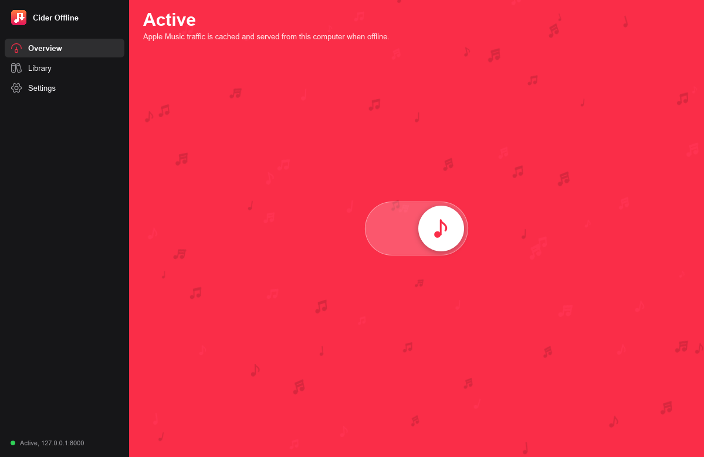

# Cider Offline

Cider Offline is a desktop app for people who listen to Apple Music in [Cider](https://cider.sh) and want it to keep working without an internet connection. It runs a small proxy on your computer. Cider sends its Apple Music traffic through that proxy, the proxy keeps a local copy of your library, and when Apple Music can't be reached it answers Cider from that copy instead.

It runs on Windows (x64, x86 and ARM64), macOS (one universal build for Intel and Apple silicon) and Linux (x86_64 and ARM64).

## What it does

- Offline mode: when Apple Music is unreachable, Cider still shows your library, searches it and plays the songs you have downloaded.
- Library sync: your playlists, albums and Songs tab are fetched from Apple Music in full and kept up to date while you are online.
- Downloads: save songs (and the audio of music videos) on your computer so they play in Cider offline. You pick the stereo mix, the spatial mix (Dolby Atmos for headphones) where a song has one, or both. Songs can also be downloaded automatically as you play them.
- Lyrics from Apple Music, Cider Community, AMLL TTML DB, Musixmatch, NetEase Cloud Music, Kugou and LRCLIB, saved locally and served to Cider offline.
- Your own audio and lyrics: give a song your own audio file or lyrics file (TTML or LRC), or add songs, albums and playlists of your own that show up in Cider's library.
- One switch to point Cider at the proxy on Windows. On macOS and Linux the app shows the command to use.
- Start at login, start minimized, a system tray icon, and a portable build that keeps everything in one folder.

## What you need

- Cider 4, the current release from the Cider Collective.
- An Apple Music subscription, signed in to Cider.
- Windows 10 or 11, macOS 11 or newer, or a Linux desktop with X11 or Wayland. On Linux the app needs `certutil` from the NSS tools; the packages pull it in.

## Where to start

1. [Install the app](installation.md) and trust its local certificate.
2. [Connect Cider](connecting-cider.md) to the proxy.
3. Use Cider online once so the app can pick up your Apple Music session and sync your library. Then download what you want to have offline. [Using the app](using.md) covers the details.

If something doesn't work, see [Troubleshooting](troubleshooting.md). To get rid of the app and everything it set up, see [Uninstalling](uninstalling.md).

## A note on use

Cider Offline is for personal use with your own Apple Music subscription, so you can keep listening to your library in Cider when you're offline. It is not affiliated with or endorsed by Apple or the Cider Collective. Use it at your own risk.

The app is open source under the MIT license. The code is at [github.com/semicolonmystery/cider-offline](https://github.com/semicolonmystery/cider-offline).
