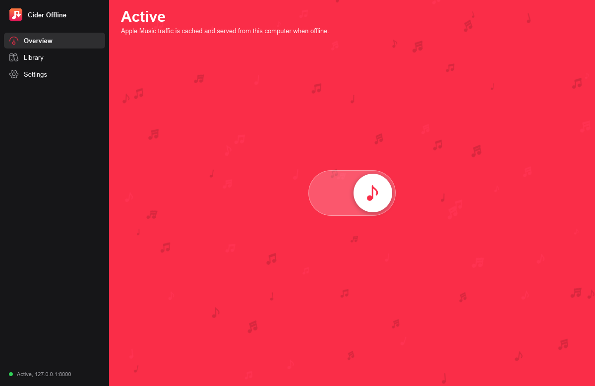
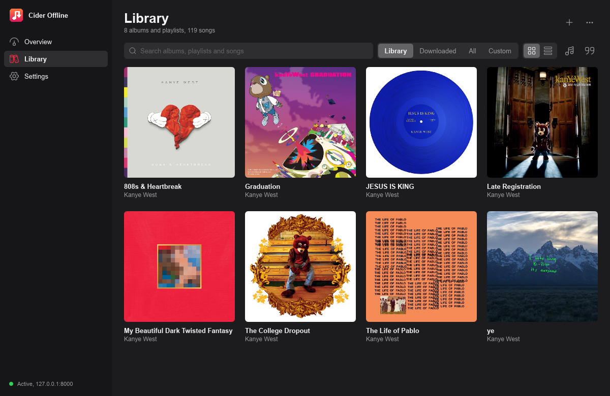
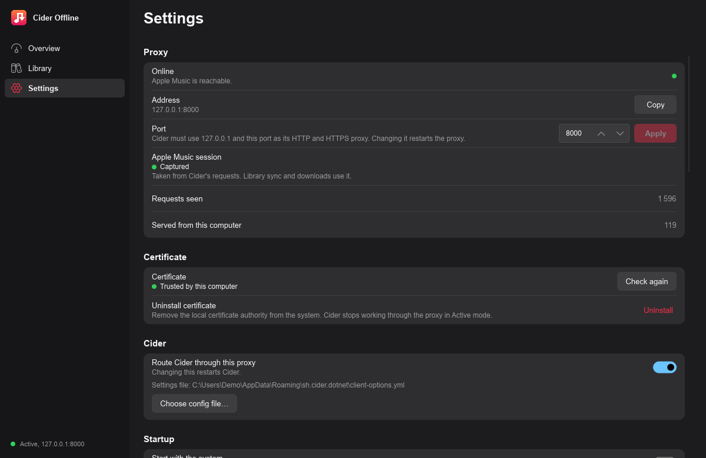

# Using the app

The window has three pages: **Overview**, **Library** and **Settings**. Closing the window doesn't stop the proxy; the app keeps running in the system tray.

## Overview

The Overview page has one control: the large switch in the middle picks the mode. Click it, or focus it with Tab and press Space or Enter.

- **Active**: Apple Music traffic is read, cached and, when Apple Music is unreachable, answered from your computer. The page turns Apple Music pink, with small music notes drifting across it.
- **Passthrough**: every connection is forwarded untouched. Nothing is read or cached, and offline mode does nothing. The page is plain.

The app always starts in Passthrough and switches to Active as soon as it finds the certificate trusted, usually within a moment. While the certificate isn't trusted it stays in Passthrough, so Cider never meets a certificate it rejects, and the line at the bottom says why. Until you flip the switch yourself, the mode follows the certificate: installing it from Settings turns Active on, uninstalling it turns Passthrough on. Once you flip the switch, your choice holds until the app is restarted.

Switching to Active sends rings out from the switch until the whole page is pink; switching back lets the plain background return from the middle. If your system is set to reduce motion (Windows: **Animation effects** off; macOS: **Reduce motion**; GNOME: animations off), the colour changes at once and the notes stand still. The notes only move while the window is open and in front: when it is minimized, in the background or hidden in the tray, the notes are taken down and nothing is animated.

When something needs your attention, one line at the bottom of the page says what, with **Go to Settings**, which opens the section where it is fixed:

- the proxy is not running or could not start;
- the certificate isn't trusted yet, or needs attention;
- Cider's settings file wasn't found, or Cider isn't routed through the proxy (Windows);
- no Apple Music session has been captured yet: play a song in Cider while it uses the proxy, so the app gets the tokens it needs for library sync and downloads.

The line follows changes as they happen: it clears as soon as an Apple Music session is captured, and the certificate and Cider's settings are read again whenever you come back to the window, so a change you made outside the app shows up then.

On Linux without a system tray, and for a macOS copy run from a read-only location, the line shows that hint instead, with **Dismiss**.

The proxy's status, address, counters, the certificate and the Cider setting are on the [Settings](#settings) page.

**Capture Apple traffic to disk** (Settings > Storage) writes every Apple Music request and response to the capture folder as JSON. It is meant for troubleshooting. The authorization, cookie and Apple Music user token headers are replaced with `<redacted>`, but the bodies are stored as they are, so look through the files before you share them.

## Offline mode

While you are online, the proxy checks every 15 seconds whether Apple Music answers (a `HEAD` request to `https://amp-api.music.apple.com/`; any HTTP answer counts as online). When the check fails, or a request to Apple fails, the proxy switches to offline mode and answers Cider itself:

- your library playlists, albums and songs, in the same order as in Apple Music;
- search across your local songs, albums and playlists, accent-insensitive;
- artwork it has stored, in whatever size Cider asks for;
- lyrics it has saved;
- playback of every song you have downloaded or linked to a local file.

Songs without local audio keep their place in the lists, but Cider shows them as unavailable and skips them when it builds a queue, so playback doesn't stop halfway through an album. Requests the proxy can't answer get an empty but valid response, so Cider's pages still load.

When Apple Music is reachable again, the proxy goes back to forwarding and Settings > Proxy says **Online** again. To try offline mode without disconnecting, set `force_offline = true` in the `[connectivity]` section of the [config](configuration.md).

## Library sync

The proxy needs your Apple Music session to sync anything. It picks up the tokens from Cider's own requests, so use Cider once while online with the proxy connected.

After that it fetches your whole library from Apple Music: every library playlist and album with its complete track list, and your Songs tab. It syncs when the app starts, every 30 minutes, when it sees new tokens, when Apple Music becomes reachable again, and when you choose **Refresh library** in the Library page's menu. It doesn't sync while offline. A sync is saved only when every request succeeded, so a failed or interrupted sync never leaves you with half a library.

### Songs page

**Settings > Library > Songs page** decides what Cider's **Library > Songs** page lists, online and offline:

- **Added to library** (the default): only the songs you added to your library yourself, the same list Apple Music shows.
- **Every song**: every song in your library, including every song of your library playlists and albums. The proxy answers this list itself, online too.

Only that one listing changes. Playlists, albums, search and playback are the same either way.

## The Library page

The Library page shows your synced albums and playlists, and every song in them. Use the search button to search it, and the filters to show only songs missing audio or missing lyrics. Open an album or playlist to see its songs.

Each song row has a download control and a menu with:

- **Download**, **Pause download**, **Resume download** or **Retry download**, depending on its state, and **Cancel download** while it is queued, running, paused or failed;
- **Link to local file…** to play your own audio file for this song, or **Unlink local file** to stop;
- **Fetch lyrics** and **Choose lyrics file…**, and **Remove lyrics** when it has lyrics (see [Removing lyrics](#removing-lyrics));
- **Re-download…** to download the song again in the current [download format](#stereo-and-spatial-mixes);
- **Remove download…** to delete the downloaded audio (asks first).

A downloaded song shows a check mark. A song with a downloaded spatial mix also shows a headphones badge next to its title (**Spatial mix (Dolby Atmos for headphones)**), and so does its row in the Downloads panel. A song with both mixes shows both marks. For the **Downloaded** view and the filters, a song counts as downloaded when it has a file of either mix; the **Downloaded** view lists only songs with a file.

An album or playlist is downloaded when every one of its songs has every mix the current [download format](#stereo-and-spatial-mixes) wants, counted from the files on your computer, and you downloaded it as a whole. Its card and page then show a check mark. When every song is on your computer only because you downloaded it through another album or playlist, or on its own, the card and page show a link instead, with **Saved through other downloads**. Click the link on its page (or choose **Link downloads** in its menu) to link those songs to this album or playlist too: nothing is downloaded again, and the songs then stay as long as this album or playlist wants them, even when you remove the other download. A partly downloaded one shows a ring filled to its share and "n of N" on the card, "n of N songs downloaded" on its page (click the ring there to download the rest), and the same count at the top of its menus. Your own songs are not counted, and a song listed twice counts once. Changing the download format can make a downloaded collection partial again: with **Stereo + Spatial**, a song you saved only in its spatial mix is missing its stereo mix.

An album or playlist has these actions for all of its songs, in its card menu and in the **⋯** menu of its page:

- **Download** (**Download missing songs** when it is partly downloaded, **Link downloads** when it is saved through other downloads; none is shown once it is downloaded): downloads only what is missing, and links the songs already on your computer to this album or playlist. A song is missing when it lacks a mix the [download format](#stereo-and-spatial-mixes) wants: with **Stereo + Spatial**, a Dolby Atmos song you have only in stereo is missing its spatial mix, and only that mix is fetched; with **Spatial where available**, it is missing too, while a song without a spatial mix is complete with its stereo mix. When the app doesn't know yet whether a song has a spatial mix, it counts as missing; the download looks it up, fetches what exists and remembers the answer. A collection counts as downloaded when no song is missing anything, by the same rule.
- **Re-download all…**: downloads every song again in the current [download format](#stereo-and-spatial-mixes) (asks first).
- **Pause downloads**, **Resume downloads** and **Retry failed downloads**, depending on its state.
- **Cancel downloads…**: stops its songs' downloads and removes them from the queue (asks first). Songs that already finished are kept.
- **Keep downloaded**: also downloads songs added to it later. They are queued after each [library sync](#library-sync). Turning it on downloads the missing songs now; turning it off keeps what is downloaded.
- **Remove downloads…**: deletes its downloaded songs (asks first; see [Shared songs](#shared-songs-and-unlinked-downloads)). Afterwards it no longer counts as downloaded. It isn't offered for an album or playlist saved only through other downloads, because it has nothing of its own to remove.
- **Fetch lyrics for all songs** and **Remove lyrics…** (asks first; see [Removing lyrics](#removing-lyrics)).

The Library menu has **Refresh library**, **Download all missing audio** and **Fetch all missing lyrics**.

Apple names one song in several ways: by its catalog id, by the id of your library copy, and by another id when it sits in one of your playlists. The app keeps such a song once, so the Library page lists it once, and its download, lyrics and playlist membership are the same whichever album or playlist you open it from.

## Downloads

A download asks Apple Music for the song the same way Cider does when it plays it, with your Apple Music session, and saves it for offline playback in Cider: an AAC `.m4a` file (256 kbps when Apple offers it, otherwise 64 kbps) in the `media` folder of the app's data folder. After a download finishes, the app looks up lyrics for the song (you can turn that off).

The download needs the Apple Music session the proxy captured from Cider. If Apple says the session ended, the song fails with "Apple Music sign-in expired: play a song in Cider while online, then retry". Do what it says.

The **Downloads** panel lists the queue. Its header has **Retry failed**, **Pause all** and **Resume all**; its **⋯** menu has **Clear finished**, **Cancel all…** (asks first; finished downloads stay), **Refresh** and **Download all missing audio**. A failed row's ring retries it, a running row's ring pauses it, a paused row's ring resumes it, and the **×** on a row cancels it. You can also add any song, album or playlist by pasting its Apple Music link or ID. Failures that are likely temporary (Apple rate limits, server errors, network errors) are retried automatically with growing pauses. A song marked "Can't download yet" can't be downloaded this way and isn't retried until you ask.

The queue holds each song once. Downloading a song that is already queued, running or paused uses that entry: a paused one resumes, and **Re-download** turns it into a re-download, so two downloads of the same song never run at the same time. Downloading a song whose file is already on disk does nothing; **Re-download** fetches it again.

Cancelling or pausing stops the transfer at once. Nothing half-written is kept: a download writes to a temporary file and moves it into place only when it is complete, and a cancelled one deletes it. A file that was already complete is never deleted by a cancel; only **Remove download** deletes files. Paused downloads start again from the beginning when you resume them.

### Shared songs and unlinked downloads

A song can be wanted by several downloads at once: two playlists, an album and a playlist, or a playlist and a single download. Its file stays while any of them still wants it. **Remove downloads…** on an album or playlist deletes only the songs nothing else needs, and its dialog says how many shared songs it keeps. **Remove download…** on a single song always deletes it.

A downloaded song becomes *unlinked* when nothing wants it any more: it left a downloaded playlist in Apple Music, or the playlist was deleted. **Settings > Downloads > Unlinked downloads** decides what happens to those files:

- **Manual** (the default): they stay until you click **Clean up now…**, which shows how many there are and how much space they use, and asks before it deletes them.
- **Automatically**: the app deletes them by itself every few hours (**Check every**, default 6 hours).

Your own songs' audio, songs one of your songs plays by reference, links to local files and songs that are still in the download queue are never cleaned up. Songs you downloaded with 0.1.0 stay linked to the playlist or album you downloaded them with.

For music videos, the app downloads the audio. A music video also offers to download the song from the album instead; its edit can differ from the video's.

Settings that affect downloads, under **Settings > Downloads**:

- **Download format**: which mix of a song a download saves; see [Stereo and spatial mixes](#stereo-and-spatial-mixes).
- **Play the other downloaded mix**: see [Stereo and spatial mixes](#stereo-and-spatial-mixes).
- **Remove lyrics when removing downloads** (off by default): **Remove download** also deletes the lyrics the app fetched for the songs whose files it deletes. Lyrics you imported stay. See [Removing lyrics](#removing-lyrics).
- **Download played songs**: **Off** (the default), **Right away** (download every song as you play it), or **When idle** (queue them, and download once nothing has played for 30 seconds).
- **Simultaneous downloads**: 1 to 6, default 2. Apple turns requests away when too many arrive at once, so 2 is the most reliable.
- **Unlinked downloads**: **Manual** or **Automatically**, with **Check every** and **Clean up now…**; see [Shared songs and unlinked downloads](#shared-songs-and-unlinked-downloads).

And under **Settings > Library**:

- **Overwrite audio**: download or import again over audio a song already has, instead of skipping it.
- **Detail level**: **Full** keeps every attribute Apple sends for a song, which makes the library, search and lyrics richer offline. **Minimal** keeps only the id, title, artist, album, duration and artwork.

### Stereo and spatial mixes

Every Apple Music song has a stereo mix. Songs mastered in Dolby Atmos also have a spatial mix: the Atmos mix rendered for headphones (still stereo AAC, 256 kbps). **Settings > Downloads > Download format** picks what a download saves:

- **Stereo only** (the default).
- **Spatial where available**: the spatial mix when the song has one, otherwise the stereo mix.
- **Stereo + Spatial**: the stereo mix, plus the spatial mix when the song has one. Each mix is a download of its own, about the same size, and the download's progress ring fills half for each.

The spatial mix is saved next to the stereo one as `<id>.spatial.m4a`. A new setting applies to the next download that starts.

**Re-download…** (in a song's, album's or playlist's menu) downloads the songs again in the current format, for example to add the spatial mix to songs you downloaded in stereo. The app asks first. Each old file keeps playing until its new file is complete, then the new one replaces it. Lyrics and links to local files stay as they are, and a mix the current format doesn't download is kept. Your own (custom) songs are skipped.

Cider asks for the spatial mix of a song when its spatial audio (Dolby Atmos) setting is on and the song is mastered in Atmos; otherwise it asks for the stereo mix. The app reads Cider's setting from its `spa-config.yml` (next to `client-options.yml`) every 30 seconds; when it can't find it, it assumes the setting is on.

- **The mix Cider asks for is downloaded**: it plays from your computer, online and offline. A spatial mix is handed to Cider as a local HLS stream of the `.spatial.m4a` file.
- **Only the other mix is downloaded**: by default, while online, Cider streams the mix it asked for from Apple Music. With **Play the other downloaded mix** on (`play_other_downloaded_mix` in the [config](configuration.md)), or while offline, it plays the mix you downloaded instead.

  **Play the other downloaded mix**: when Cider asks for a mix you haven't downloaded (stereo or spatial), play the one you did download instead of streaming from Apple. Offline, this always happens.
- **Nothing is downloaded**: online, Cider streams from Apple Music; offline, the song is unavailable.

So with the default settings, an Atmos song you downloaded only in stereo streams its spatial mix from Apple while you're online and Cider's spatial audio is on. Turn the setting on, or turn spatial audio off in Cider, to play your download instead.

## Lyrics

When Cider fetches lyrics from Apple while online, the proxy saves them. Offline it serves the saved lyrics. For songs Apple has no lyrics for, you can fetch them from other providers. These are asked in this order by default:

1. Apple Music
2. Cider Community (lyrics submitted by Cider users)
3. AMLL TTML DB
4. Musixmatch (through Cider's lyrics service)
5. NetEase Cloud Music
6. Kugou
7. LRCLIB

Under **Settings > Lyrics** you can turn providers off and change the order. The other options there:

- **Search until**: providers are asked in order until lyrics of this quality turn up: **Word-synced (best)**, **Line-synced** or **Any lyrics**. If none do, the best lyrics found are kept.
- **When a lookup fails** (rate limit, server error, timeout): **Skip, retry at the end** asks again for the skipped songs once the rest are done; **Wait and retry** waits and asks the same provider again before moving on; **Skip** leaves the song without lyrics until you fetch again. "No lyrics found" is not a failure.
- **Always use downloaded lyrics**: while online, answer Cider's lyrics requests with the saved lyrics instead of asking Apple. Songs without saved lyrics still get Apple's.
- **Fetch after downloading**: look up lyrics for every song once its download finishes.
- **Overwrite lyrics**: when fetching for a whole album or playlist, or after a download, look up songs that already have lyrics again. Apple lyrics are always kept. Fetching lyrics for a single song always looks them up.

**More options** has the providers the failure rule applies to, one checkbox per line (the others always wait and retry), the pause between two LRCLIB lookups, and how many retry passes run at the end.

### Removing lyrics

The saved lyrics of a song are deleted from the `lyrics` folder in three ways:

- **Remove lyrics** in a song's menu deletes all of its lyrics, the lyrics you chose with **Choose lyrics file…** included. When the song has such lyrics, it asks first.
- **Remove lyrics…** in an album's or playlist's menu deletes the lyrics of all its songs, after asking. Lyrics you chose yourself are kept.
- With **Settings > Downloads > Remove lyrics when removing downloads** on, **Remove download** on a song, album or playlist also deletes the lyrics of the songs whose files it deletes. Lyrics you chose yourself are kept, and so are the lyrics of shared songs whose files stay.

A song whose lyrics are removed shows no lyrics until you fetch them again (or Cider gets them from Apple while online).

## Your own audio and lyrics

**Link to local file…** in a song's menu plays your own file for that song instead of Apple's stream. Supported types are `m4a`, `mp3`, `flac`, `aac`, `alac`, `wav`, `ogg` and `opus`. The file stays where it is; the app only remembers its path.

**Choose lyrics file…** sets lyrics from a TTML or LRC file. Lyrics you choose this way always win: Cider gets them online and offline, whatever the other lyrics settings say.

The add button on the Library page (**Add a song, album or playlist**) adds a song, album or playlist of your own. A song can have a title, artist, album, artwork, a release date, a description and more, an audio file or the audio of another Apple Music song (by its ID), and a lyrics file. It can go into one of your albums or playlists, or into a new album. These items show up in Cider like the rest of your library: in the library lists, in search and in playback, online and offline. Your own items have **Edit details…** and **Delete…** in their menu, and songs in your own playlists can be moved up and down.

## Start at login and the tray

**Settings > Startup** has **Start with the system**, which launches the app when you sign in, and **Start minimized**, which starts it hidden in the tray. The login entry always starts the app minimized.

The tray menu (the menu bar on macOS) shows the proxy's status and has **Passthrough** and **Capture** switches, **Open window** and **Quit**. On Windows and Linux, clicking the icon opens the window. The icon changes with the mode.

Closing the window hides it to the tray. **Quit** stops the proxy and exits.

On Linux the tray needs a StatusNotifierItem host. KDE has one; on GNOME install the "AppIndicator and KStatusNotifierItem Support" extension. Without one, the app shows a one-time hint, the minimize button minimizes, the close button quits, and "start minimized" starts minimized instead of hidden. If the tray goes away while the window is hidden (for example when the panel restarts), the window comes back.

Only one copy of the app runs at a time. Starting it again brings up the window of the one that is running. On macOS, opening the app again from Finder, Launchpad or Spotlight doesn't do this; use **Open window** in the menu bar icon. An installed copy and a portable copy have separate data, so they can run side by side.

## Settings

Most of the Settings page is described above. The rest:

- **Proxy**: whether the proxy is online or offline (serving from this computer), its address with a **Copy** button, the **Port** it listens on (changing it restarts the proxy; point Cider at the new port too), whether an **Apple Music session** has been captured from Cider, and how many requests the proxy has seen and how many it answered itself.
- **Certificate**: whether the local certificate is trusted, with **Install** (or **Fix**) and **Check again**, and **Uninstall certificate**, which removes it from your system (Cider then stops working through the proxy in Active mode). See [Installation](installation.md#first-run-and-the-local-certificate).
- **Cider**: **Route Cider through this proxy** (Windows), with the Cider settings file in use and **Choose config file…** below it, or the steps for macOS and Linux. See [Connecting Cider](connecting-cider.md).
- **Storage**: open the data folder or the capture folder; **Capture Apple traffic to disk**; **Clear cache** deletes cached Apple Music responses and artwork, and keeps your downloaded audio, linked files and your own songs; **Remove all data…** is described in [Uninstalling](uninstalling.md#remove-all-data).

Settings are saved to `config.toml`. [Configuration](configuration.md) lists every option, including a few that are only in the file.
